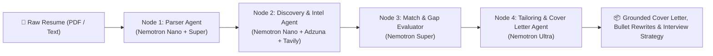

# AutoApply AI — Powered by NVIDIA Nemotron on Nebius Token Factory

[](./LICENSE)
[](https://studio.nebius.ai/)
[](https://www.nvidia.com/)
[](https://tavily.com/)

> Built for the **Nebius x NVIDIA Global AI Hackathon** | **Track:** Best Apps and Agents Track (+ Best Use of Tavily Bonus)

## Overview
**AutoApply AI** is an autonomous 4-agent career orchestration platform that transforms raw resumes into hyper-personalized, company-grounded job application packages. By orchestrating **NVIDIA Nemotron (Nano, Super, and Ultra)** via **Nebius Token Factory**, it delivers frontier-grade cover letter and resume bullet synthesis while keeping intent guardrails, query planning, and structured JSON extraction fast and cost-efficient.

## How We Used NVIDIA Nemotron & Nebius Token Factory

Instead of routing every prompt to a massive frontier model, our architecture implements dynamic **Three-Tier Nemotron Routing** through Nebius Token Factory's OpenAI-compatible API (`https://api.studio.nebius.ai/v1/`):

| Tier | NVIDIA Open Source Model | Role in Pipeline | Why This Tier |
|---|---|---|---|
| **Tier 1 (Fast)** | `nvidia/Llama-3_1-Nemotron-Nano-8B-v1` | Resume intent guardrails, fast skill tag extraction, Adzuna/Tavily search query planning, live company signal triage | Sub-second latency (`temp=0.1`, `max_tokens=512`), minimal credit consumption |
| **Tier 2 (Balanced)** | `nvidia/Llama-3_3-Nemotron-Super-49B-v1` | Structured JSON resume schema extraction, semantic job match scoring (0–100%), missing keyword gap analysis | High accuracy on strict JSON schemas & multi-dimensional evaluation (`temp=0.2`, `max_tokens=2048`) |
| **Tier 3 (Reasoning)** | `nvidia/Llama-3_1-Nemotron-Ultra-253B-v1` | Project-grounded ATS resume bullet rewrites, Tavily-informed cover letter generation, technical interview prep strategy | Frontier-grade reasoning (`temp=0.6`, `max_tokens=4096`) for high-stakes synthesis |

## 4-Node Autonomous Multi-Agent Pipeline (`src/agents/workflow.py`)



1. **Node 1 — Parser Agent (`Nemotron Nano` + `Nemotron Super`):** Validates resume input and extracts candidate skills, categorized tech stacks, quantified work history, and project outcomes into strict JSON.
2. **Node 2 — Discovery & Intel Agent (`Nemotron Nano` + `Adzuna API` + `Tavily Search API`):** Optimizes search queries, retrieves live matching job openings from Adzuna, and pulls recent engineering blog posts, infrastructure announcements, and news about the hiring company via Tavily.
3. **Node 3 — Match & Gap Evaluator (`Nemotron Super`):** Computes a semantic match score (0–100%) across Technical Alignment, Experience Depth, and Company Stack Fit, pinpointing matched keywords and exact missing skill gaps.
4. **Node 4 — Tailoring & Cover Letter Agent (`Nemotron Ultra`):** Synthesizes a publication-ready cover letter weaving together the candidate's real projects and Tavily company intelligence, alongside Before/After ATS resume bullet rewrites and a 3-pillar interview prep strategy.

## What Was Significantly Updated During the Hackathon Period
*(Included per Official Hackathon Rules for evolved/existing projects)*
1. **Nebius Token Factory Migration:** Engineered the core LLM inference layer (`src/llm/nebius_client.py` & `src/llm/nebius_router.py`) to run 100% on Nebius Token Factory using open-source NVIDIA Nemotron models.
2. **Multi-Model Tier Router:** Built a custom routing engine that dynamically dispatches tasks across Nemotron Nano, Super, and Ultra, cutting workflow credit overhead by >50% compared to an all-Ultra baseline.
3. **Live Telemetry & Cost Inspector:** Added a real-time observability sidebar and dedicated telemetry tab displaying per-step model selection, token throughput (`tok/s`), latency (`ms`), credit savings percentage, and full JSON request traces.
4. **Tavily Live Company Intelligence + Demo Protection Guardrails:** Integrated live company engineering research via Tavily Search API and added SHA-256 semantic response caching plus session rate limiting so the public demo stays responsive throughout judging.

## Quickstart & Local Setup

### 1. Clone & Install Dependencies
```bash
git clone https://github.com/<your-username>/autoapply-nebius-nvidia.git
cd autoapply-nebius-nvidia
python -m venv venv
source venv/bin/activate  # Windows: venv\Scripts\activate
pip install -r requirements.txt
```

### 2. Configure Environment Variables
```bash
cp .env.example .env
```
Add your `NEBIUS_API_KEY` (and optional `TAVILY_API_KEY`, `ADZUNA_APP_ID`, `ADZUNA_API_KEY`) to `.env`, or enter them directly in the Streamlit sidebar under **API Credentials & Demo Controls**.

### 3. Launch the Application
```powershell
# Windows PowerShell (runs via python -m to avoid Windows Smart App Control blocking wrapper .exe shims)
.\.venv\Scripts\python.exe -m streamlit run app.py

# Or if virtual environment is activated:
python -m streamlit run app.py
```

### 4. Run Automated Verification Tests
```powershell
.\.venv\Scripts\python.exe -m pytest -v
```
